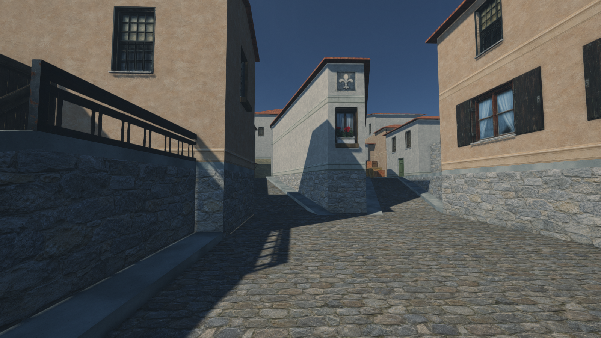
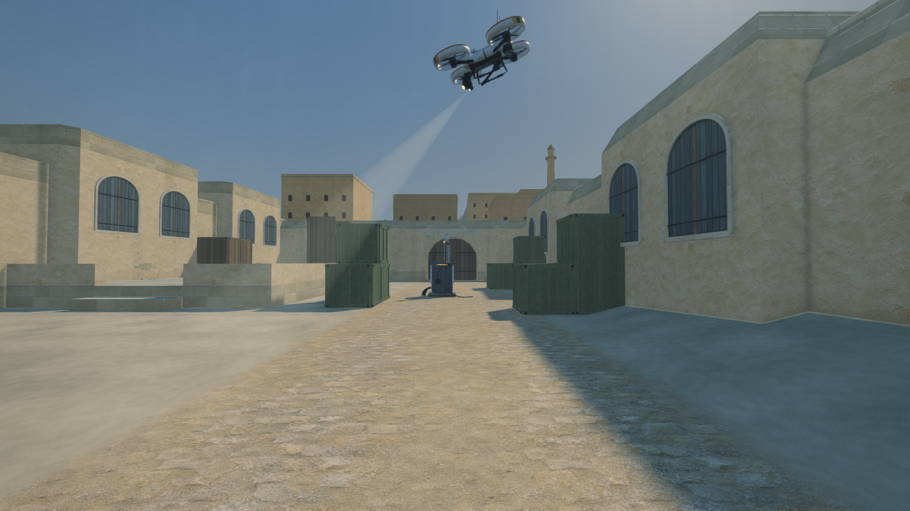

# Saltline · Assault + Dust + Italy

A remix of **Saltline**, the fully procedural browser FPS by [Felix Rieseberg](https://x.com/felixrieseberg/status/2119925633564463609) ([play the original](https://claude.ai/artifact/BGY1SztrAYcJQHSsnHHGmp)). The original procedural asset library is retained. Dust additionally includes two generated desert image textures. Three.js and game assets are bundled; UI fonts are requested from Google Fonts.

**Italy is an additional map:** open **http://127.0.0.1:8767/italy.html**, or choose **Italy** on the map menu. Its complete `cs_italy.bsp` layout includes the market, apartment passages, cellar, terraces, native crates and two-storey house. It uses Saltline's rifle, security robots and three-uplink extraction mission. A is in the market, B in the apartments, C upstairs in the house; extraction is at the CT approach.

Italy adds generated plaster, limestone, cobbles and terracotta; source-aligned window, door, textile and crate remasters; recreated missing gate, railing, ivy and wine-rack textures; 101 recessed windows, source-aligned masonry and interior joinery, and photographic afternoon lighting. **Space** jumps and **C / Ctrl** crouches. To use the native crate-to-window route, jump up the crate staircase, sprint-jump toward the opening and crouch while airborne. Standing is blocked by the low sill opening. Automated keyboard/mouse testing has completed the crate-to-window route, including blocked standing under the opening and landing inside the upper house. The final build also completes C/B/A/extraction in the same continuous run and resets correctly on Redeploy; the acceptance review records exact builds and remaining visual limits. The controller preserves airborne momentum and checks headroom when standing again.

The map preserves the source geometry and existing Saltline mission rules. Counter-Strike multiplayer rounds and hostage escort AI are not implemented. The supplied archive lacks the original NPC models and ambient WAV files; new chicken/bottle geometry and the shared Saltline sound bank are used. The photorealistic AAA visual target remains unmet, independently of the successful geometry and gameplay checks. See the [Italy brief](docs/ITALY-BRIEF.md), [source review](docs/ITALY-SOURCE-REVIEW.md), [asset provenance](docs/ITALY-ASSETS.md), [latest visual critique](docs/ITALY-VISUAL-CRITIQUE-4.md) and [acceptance review](docs/ITALY-REVIEW.md).



**Dust is an additional map:** open **http://127.0.0.1:8767/dust.html**, or choose **Dust** on Assault's title screen. The supplied Counter-Strike 1.6 `de_dust.bsp` supplies the full layout: both sites, central tunnel, bridge, underpass, ramps, crates and native spawn areas. The map retains Saltline's single-player rifle/robot/uplink mission. Counter-Strike team rounds, buying and bomb planting are not implemented.

Dust adds dry desert lighting and ambience, nine PBR material sets, generated lime plaster and sand-buried paving, architectural joinery, crate hardware and distant desert settlement. Disable A in the CT courtyard, B in the eastern courtyard and C in the underpass; return to extraction at the T approach. The full mission has passed automated browser-input verification. The photorealistic AAA visual target remains unmet. See the [Dust brief](docs/DUST-BRIEF.md), [asset provenance](docs/DUST-ASSETS.md), [source review](docs/DUST-SOURCE-REVIEW.md) and [verification record](docs/DUST-REVIEW.md).



The supplied Counter-Strike 1.6 `cs_assault.bsp` is rebuilt inside Saltline, preserving its procedural materials, props, weapon, security robots, effects, audio, and rendering pipeline. The warehouse, loading yard, office, upper ramps, roof, vents, ladders, and surrounding streets come from the actual BSP geometry.

The current revision refines the ship hull and building materials, exposes more container rows from the western road and roof, and corrects ladder mounts, fence frames and intersecting cargo. See the [latest review](docs/ASSAULT-V10-REVIEW.md) for placement audits, frame pacing and full-route tests.

## Play

Run `npm start` and open **http://127.0.0.1:8767/** in a desktop browser with WebGL2. `index.html` is standalone Assault, `dust.html` is standalone Dust, `italy.html` is standalone Italy, and `original.html` is the untouched Saltline original. No JavaScript dependencies are required to build or serve the games. Python 3 builds them; Node runs the physics checks.

In **Assault**, disable A in the loading hall, B in the operations office and C on the roof. In **Dust**, disable A in the CT courtyard, B in the eastern courtyard and C in the underpass. Return to the marked extraction perimeter near the starting approach. In **Italy**, disable A in the market, B in the apartments and C upstairs in the house, then return to the CT extraction approach. All three remixes retain Saltline's single-player mission and robot enemies.

| Action | Controls |
| --- | --- |
| Move / look | WASD / mouse; arrow keys also turn |
| Fire / aim | Left / right mouse button; Enter also fires |
| Sprint / jump | Shift / Space |
| Crouch / reload | C or Ctrl / R |
| Disable uplink | Hold E when close and visible |
| Melee | F or V |
| Climb a ladder | Move forward against it; look down to descend |
| Pause / resume | Escape or P / Resume button |

On Assault, reach the loading platform with a jump and the office via the two warehouse ramps. Crouch in the vents. Doors open on approach; destructible grilles and glass respond to gunfire. Dust preserves its native ramps, bridge/underpass overlap and solid crate cover; it has no ladders or moving doors.

`?q=high&dynres=0&seed=4207` selects fixed high quality. Original inspection modes such as `?show=mats` and `?show=enemies` remain available.

## Build and inspect

```sh
npm run build
npm test
npm run map:inspect
```

- `tools/extract-assault.py` reads the supplied archive and writes `src/assault-map.json` with hard normals, physical UVs, collision, doors, breakables, and ladders.
- `src/assault-*.js` contains the readable physics, scene, dressing, and wet-ground integration.
- `tools/build-assault.py` embeds those modules and map data into `index.html` alongside the preserved engine and asset library.
- `tools/extract-dust.py` preserves the full Dust BSP scene, source/physical UVs, collision surface ranges, triggers and sites in `src/dust-map.json`.
- `src/dust-*.js`, `assets/dust/` and `tools/build-dust.py` produce the additional `dust.html`. `npm run build:dust` rebuilds just Dust.
- `tools/extract-italy.py`, `src/italy-*.js`, `assets/italy/` and `tools/build-italy.py` produce `italy.html`. `npm run build:italy` rebuilds Italy. Optional `python3 tools/encode-italy-textures.py` prepares compact JPEG delivery copies while preserving generated PNG originals and alpha cutouts.
- `reference/` preserves the user's Grok draft and source archive. The draft is source/reference, not the new map implementation.

## Source study and Codex skill

[Read the Saltline study](docs/SALTLINE-STUDY.md) for verified implementation details, provenance limits, runtime observations, and transferable production techniques.

The reusable [high-fidelity-game-dev skill](skills/high-fidelity-game-dev/SKILL.md) includes focused references, production/review templates, and a frame-time report script. Invoke it as `$high-fidelity-game-dev` once installed in your Codex skills directory.

## Quality and evidence

See [the production brief](docs/ASSAULT-BRIEF.md) and [the review record](docs/ASSAULT-REVIEW.md) for input-based traversal, measured rendering conditions, and remaining limitations. The target is photorealistic AAA presentation; the current result is a playable procedural remake and does **not** establish that target. The source map silhouettes and procedural asset fidelity still limit some views.


Earlier screenshots and [gantry remix notes](docs/SALTLINE-GANTRY-README.md) are preserved. The source map archive and its attribution are unchanged. Game geometry, materials, models, and sound are embedded/generated locally; the UI has local fallback fonts when Google Fonts is unavailable.

Credit for the original engine, procedural asset library and audio goes to Saltline; the supplied Dust BSP credits Dave Johnston. New desert art and integration are documented in the Dust asset record.
