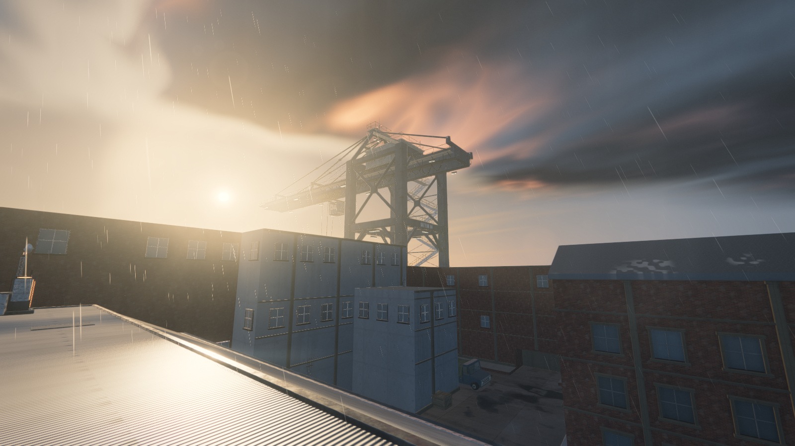
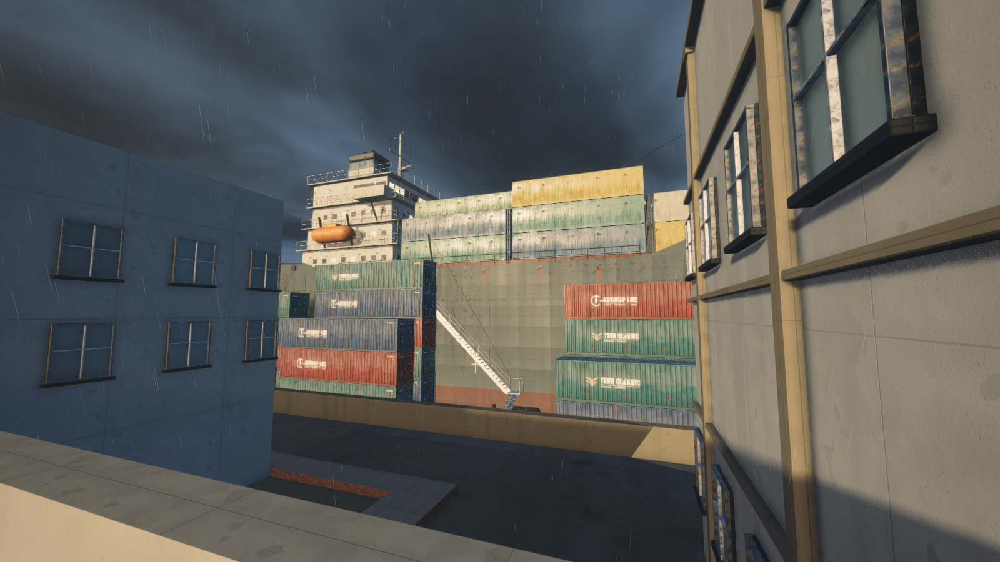

# Saltline · Assault

A remix of **Saltline**, the fully procedural browser FPS by [Felix Rieseberg](https://x.com/felixrieseberg/status/2119925633564463609) ([play the original](https://claude.ai/artifact/BGY1SztrAYcJQHSsnHHGmp)). Game textures, models and sounds are generated in code. Three.js is bundled; UI fonts are requested from Google Fonts.

The supplied Counter-Strike 1.6 `cs_assault.bsp` is rebuilt inside Saltline, preserving its procedural materials, props, weapon, security robots, effects, audio, and rendering pipeline. The warehouse, loading yard, office, upper ramps, roof, vents, ladders, and surrounding streets come from the actual BSP geometry.

The current revision refines the ship hull and building materials, exposes more container rows from the western road and roof, and corrects ladder mounts, fence frames and intersecting cargo. See the [latest review](docs/ASSAULT-V10-REVIEW.md) for placement audits, frame pacing and full-route tests.

## Play

Run `npm start` and open **http://127.0.0.1:8767/** in a desktop browser with WebGL2. `index.html` is the generated standalone game; `original.html` is the untouched Saltline original. No JavaScript dependencies are required to build or serve the game. Python 3 builds it; Node runs the physics checks.

Disable the three uplinks: A in the loading hall, B in the operations office, and C on the roof. Return to the marked rescue perimeter near the starting approach. Saltline's single-player mission and robot enemies are retained.

| Action | Controls |
| --- | --- |
| Move / look | WASD / mouse; arrow keys also turn |
| Fire / aim | Left / right mouse button; Enter also fires |
| Sprint / jump | Shift / Space |
| Crouch / reload | C or Ctrl / R |
| Disable uplink | Hold E when close and visible |
| Melee | F or V |
| Climb a ladder | Move forward against it; look down to descend |
| Pause | Escape or P |

The loading platform is reached with a jump. The office is accessible via the two warehouse ramps. Crouch in the vents. Doors open on approach; destructible grilles and glass respond to gunfire.

`?q=high&dynres=0&seed=4207` selects fixed high quality. Original inspection modes such as `?show=mats` and `?show=enemies` remain available.

## Build and inspect

```sh
npm run build
npm test
npm run map:inspect
```

- `tools/extract-assault.py` reads the supplied archive and writes `src/assault-map.json` with hard normals, physical UVs, collision, doors, breakables, and ladders.
- `src/assault-*.js` contains the readable physics, scene, dressing, and wet-ground integration.
- `tools/build-assault.py` embeds those modules and map data into `index.html` alongside the preserved engine and asset library.
- `reference/` preserves the user's Grok draft and source archive. The draft is source/reference, not the new map implementation.

## Source study and Codex skill

[Read the Saltline study](docs/SALTLINE-STUDY.md) for verified implementation details, provenance limits, runtime observations, and transferable production techniques.

The reusable [high-fidelity-game-dev skill](skills/high-fidelity-game-dev/SKILL.md) includes focused references, production/review templates, and a frame-time report script. Invoke it as `$high-fidelity-game-dev` once installed in your Codex skills directory.

## Quality and evidence

See [the production brief](docs/ASSAULT-BRIEF.md) and [the review record](docs/ASSAULT-REVIEW.md) for input-based traversal, measured rendering conditions, and remaining limitations. The target is photorealistic AAA presentation; the current result is a playable procedural remake and does **not** establish that target. The source map silhouettes and procedural asset fidelity still limit some views.





Earlier screenshots and [gantry remix notes](docs/SALTLINE-GANTRY-README.md) are preserved. The source map archive and its attribution are unchanged. Game geometry, materials, models, and sound are embedded/generated locally; the UI has local fallback fonts when Google Fonts is unavailable.

All credit for the engine, assets and audio goes to the original Saltline.
