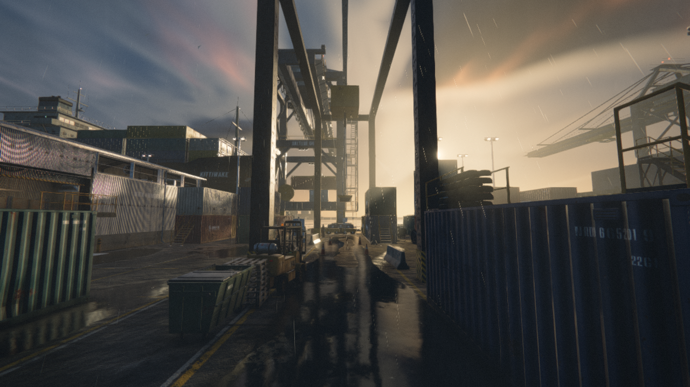
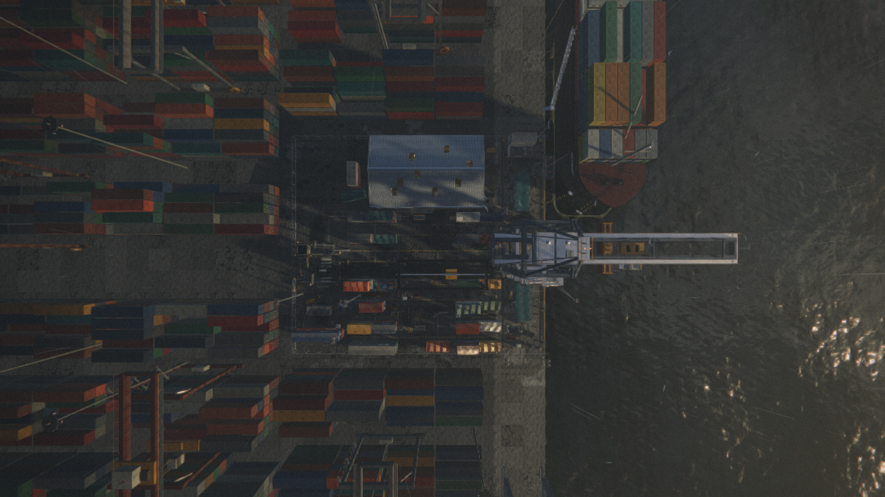
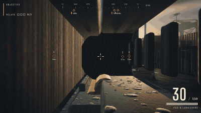
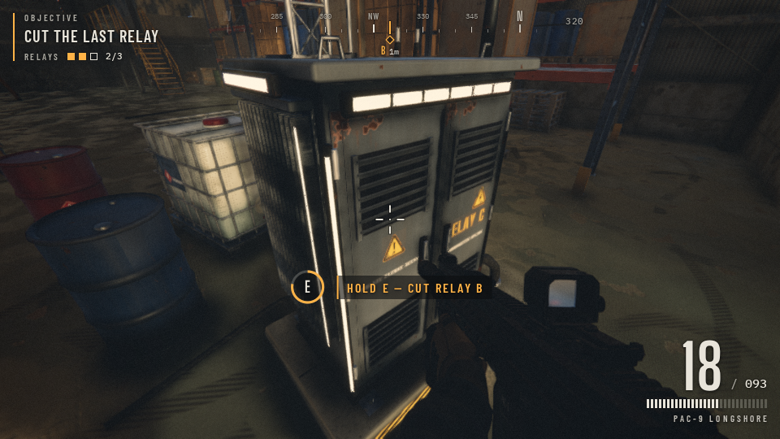
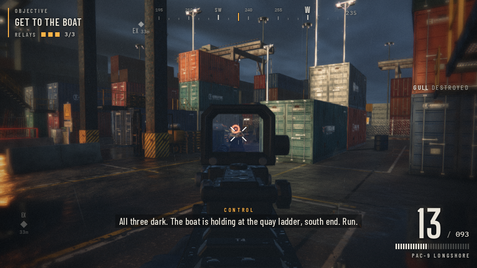
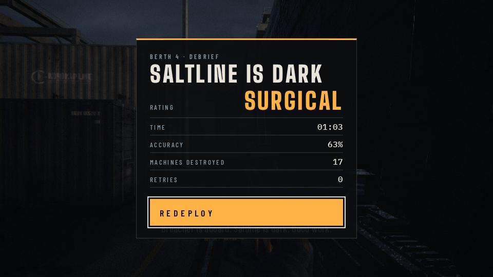

# Saltline Remix

A remix of **Saltline**, the fully procedural browser FPS by [Felix Rieseberg](https://x.com/felixrieseberg/status/2119925633564463609) ([play the original](https://claude.ai/artifact/BGY1SztrAYcJQHSsnHHGmp)). Every texture, model and sound is generated in code; nothing is downloaded.

This remix keeps all of the original's materials, props, enemies, weapon, effects and audio, and swaps in a new map layout:

- A central RTG crane gantry ("RTG-07") with a corridor running beneath it
- A denser maze of stacked 20' and 40' containers, with catwalks and stairs
- Relays moved: A in the container yard, B inside the shed, C on the north quay
- Extraction boat moved to the south pier

## Play

Open `index.html` in a modern desktop browser (WebGL2 required). `original.html` is the unmodified game for comparison.

Handy URL params from the original: `?show=mats`, `?show=enemies`, `?show=level` to view one module, `?tex=512` for lower texture resolution, `?bench` for a benchmark flythrough.

## Status

Boots to the title and starts a game. A scripted bot now plays the whole mission headless. It cuts all three relays and reaches the boat without god-mode (see below). Ladders, catwalks and the upper levels aren't covered by the bot, which stays on the ground-level nav grid.




## Scripted playthrough (no GPU needed)

`index.html?dbg=1` turns on a debug hook. It pauses the normal render loop and exposes `window.__dbg`, so a script can step the game at a fixed 1/60 s timestep, independent of how fast the machine renders. A bot (`scripts/playthrough/bot.js`) uses it to walk to each relay on the game's own nav grid (`physics.nav.findPath`), cut it, fight off Gulls and Hounds, and then run for the boat.

```sh
cd scripts/playthrough
npm install
npx playwright install chromium      # or pass --chrome /usr/bin/google-chrome
node run.mjs                         # no god-mode; exits 0 only if 3/3 relays are cut and you extract
node run.mjs --god --video           # invulnerable player, plus out/playthrough.mp4 and .gif (needs ffmpeg)
```

Options: `--seed N` (default 4207), `--max-frames 36000` (the frame budget, 10 minutes of game time), `--shot-every 2` (seconds of sim time between screenshots), `--out DIR` (default `out/`), `--order relay_a,relay_b,relay_c` (default: nearest relay next), `--inf-ammo`, `--width`/`--height`, `--headed`. The runner prints a JSON summary, which it also writes to `out/summary.json`. It exits non-zero with a reason if the run fails: 2 means the objective wasn't completed, 3 means a boot or script error.

Runs are deterministic. With `?dbg=1`, `Math.random` and the game RNG are seeded, and simulation ticks draw from a separate stream from anything asynchronous (texture baking, UI). The same seed gives the same run frame for frame, however often you take screenshots.

`window.__dbg` API: `start()`, `step(dt, n, draw)`, `draw()`, `st()` (state, hp, ammo, position, relays, extraction, won/lost), `set({yaw, pitch, move:{x,y}, keys, fire, ads, sprint, crouch, interact, jump, reload, god, infAmmo, hp})`, `reload()`, `enemies()`, plus `G`, `camera` and `nav`. Normal play without `?dbg=1` is unchanged.

Result on a box with no GPU (seed 4207, no god-mode): all 3 relays cut and the boat reached at 63.7 s of mission time (4,095 frames, 17 kills, 52 of 82 shots hit, lowest HP 93). The whole run takes about 45 s of wall time without screenshots.






CI: `scripts/playthrough/ci/playthrough.yml` is a ready-made GitHub Actions workflow that runs the bot on PRs and uploads the screenshots. Copy it to `.github/workflows/` to turn it on.

The fixed-timestep hook and bot pattern come from [wquguru/fable52-fps-repro](https://github.com/wquguru/fable52-fps-repro) (MIT), whose `scripts/rec/auto04.js` drives its FPS demo the same way.

All credit for the engine, assets and audio goes to the original Saltline.
