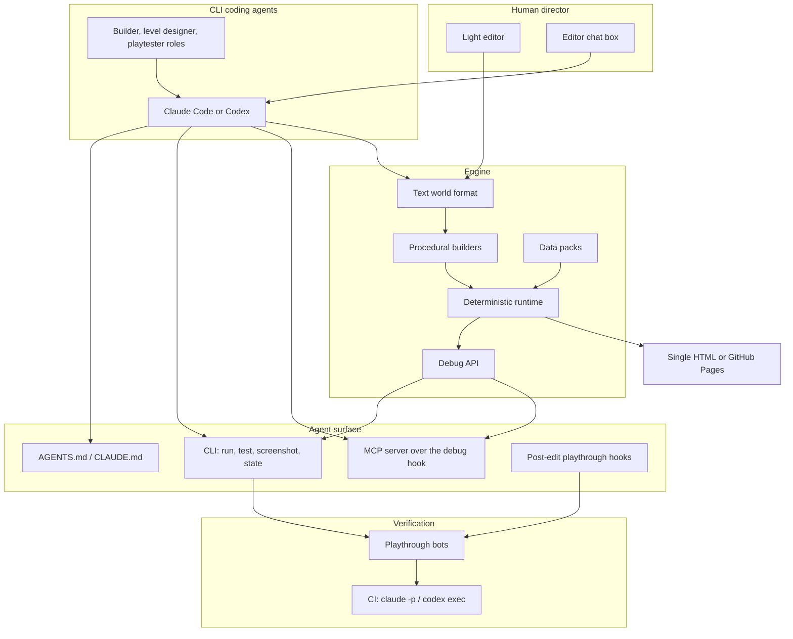

# An AI-native, browser-first game engine

Unreal Engine is built around a person clicking in a viewport. Saltline, Felix Rieseberg's procedural browser FPS, points at a different kind of engine: one where a coding agent is the main author and a human is the director. The whole game is plain text in one runnable file. The engine proves its own changes by playing the game.

This document sketches that engine and a light editor, and a path to a first version we can grow out of this repository.

The builders we have in mind are existing CLI coding agents — [Claude Code](https://docs.anthropic.com/en/docs/claude-code) and [OpenAI Codex](https://github.com/openai/codex) — not a custom in-house agent. The engine should be designed so those tools can read the project, edit the world, run and inspect the game, and verify their own work, using the conventions they already understand. The design stays vendor-neutral between the two: every surface has a counterpart on both, even when the names differ (`AGENTS.md` / `CLAUDE.md`, Codex custom prompts / Claude Code skills and subagents, `codex exec` / `claude -p`).

## Lessons from Saltline

Saltline is a complete first-person shooter in a single HTML file. A few properties of that approach are worth treating as engine requirements, not as happy accidents:

- **One self-contained HTML file, with no downloaded assets.** An agent can read and rewrite the entire game. Textures, models and sound are generated in code, so there is no binary asset library to keep in sync or to hide from the agent.
- **The level is data and code, not a hand-placed scene.** Rooms, cover, objectives and spawns are described in a form a coding agent can edit, then turned into geometry by builders.
- **Seeded random numbers make every run repeatable.** The same seed produces the same mission, frame for frame, which is what makes automated playtesting honest.
- **A debug hook can take over the game.** `index.html?dbg=1` pauses the render loop and exposes `window.__dbg`: pause, step at a fixed timestep, inject input, read state, place the player, toggle god mode and infinite ammo. Ordinary play without the flag is unchanged.
- **A bot can play the game and report a win or a failure.** In [pull request #1](https://github.com/lgcarrier/saltline-remix/pull/1), `scripts/playthrough` drives that hook from Playwright, walks the nav grid, completes the objectives and exits `0` on a win, `2` on an objective failure and `3` on a boot or script error. That bot is the engine's equivalent of Unreal's Play button, except it can run on its own.

These are the pieces to extract, not to reinvent.

## Architecture

The human steers. The coding agent edits the text world. The runtime and the playthrough bots tell both of them whether the change actually works.

## Components

### 1. A tiny deterministic runtime

A small engine core that runs in the browser:

- Rendering with three.js or WebGPU
- Physics and collision
- Audio
- Input
- A fixed-step game loop

Determinism and controllability are not add-ons. The debug API is built in from the start, with the same shape as today's `window.__dbg` (`start`, `step`, `draw`, `st`, `set`, `reload`, `enemies`, plus access to the game, camera and nav). Simulation ticks draw from a random stream that is isolated from asynchronous work such as texture baking or UI, so a seed plus a sequence of inputs always reproduces the same run.

### 2. A text world format

Levels, entities, weapons and rules live in readable JSON or a small scripting language, in the spirit of "a warehouse with three relays, guards on a patrol, extraction to the north." The agent edits that description. It does not sculpt raw meshes.

The format should be stable, diff-friendly and boring: named entities, volumes, objectives, spawn and patrol data, and references to data packs. Geometry is derived from it, not stored as the source of truth. When a person drags something in the editor, the editor writes the change back into this text.

### 3. Procedural builders

Generators turn the world description into real geometry and presentation: rooms and corridors, buildings, terrain, cover, lighting, sound made in code, and textures made in code. This is what keeps a game asset-free in the Saltline sense, and what lets an agent change a place by changing a description rather than a content pipeline.

Builders should be deterministic given a seed, cheap enough to rerun after every edit, and inspectable (so a test can ask "is the extraction reachable from objective B?" without rendering a frame).

### 4. An agent surface for Claude Code and Codex

We do not build our own agent. We make the engine a good project for the CLI coding agents people already run.

The precedent is [wquguru/fable52-fps-repro](https://github.com/wquguru/fable52-fps-repro) (MIT). Its `scripts/run.sh` is a headless Claude Code runner: a builder system prompt, API docs, and a loop of edit, run, screenshot, read state, then fix, with [agent-browser](https://github.com/vercel-labs/agent-browser) used to verify the result. Prompt caching brought its 04-fps run from about $60 down to about $16, with a 90.9% cache hit rate. We want that same loop, but expressed as ordinary Claude Code and Codex workflows instead of a one-off runner.

The engine should provide:

- **Project conventions and API docs in `AGENTS.md` and `CLAUDE.md`.** These files tell the agent how the runtime, world format, debug hook and CLI work, what it may edit, and how to check a change. Keep the two documents aligned so neither vendor becomes a special case.
- **A CLI the agent can call, with JSON on stdout.** Commands such as `engine run --seed 4207`, `engine test`, `engine screenshot`, and `engine state` should be enough to boot a seed, step or play a bot, capture a frame, and read hp, ammo, position, objectives and win/lose state. Structured output matters: agents parse JSON reliably; they do not parse screenshots of log windows reliably.
- **An MCP server over the debug hook.** Expose step, state, input and screenshot so Claude Code or Codex can attach to a running game and drive it live, not only in batch. The MCP tools should be a thin, documented wrapper around the same API the CLI uses.
- **Role-specific guidance.** Claude Code skills and subagents, or Codex custom prompts, for at least three roles: a *builder* that changes engine code and data packs, a *level designer* that edits the text world, and a *playtester* that runs seeds, files stuck spots and balance issues, and reports a pass or fail. Same roles, two packaging formats.
- **Hooks that verify after edits.** A Claude Code hook (and the closest Codex equivalent) should run the playthrough bot after a world or runtime change, so a broken path or an unwinnable objective shows up before the agent stops.
- **Headless agent runs in CI.** `claude -p` and `codex exec` can apply a requested change, run the bot across seeds, and leave a report on the pull request. Budget and permissions for those runs need a hard cap.
- **The editor chat box as a front door, not a second agent.** When a person types "make B site tighter" in the editor, that request is sent to a local Claude Code or Codex session in the project, which then uses the CLI, MCP and hooks above. The editor does not grow its own planner or tool loop.

The loop is still edit, run, screenshot, read state, fix. The difference is that Claude Code or Codex *is* that loop.

### 5. Automatic testing

Bots play the game across many seeds and check that:

- Each objective can be completed
- The player cannot get stuck
- Balance holds (time to kill, ammo, economy)
- Screenshots still match the last accepted version, or a human has signed off on the diff

This is how most changes get verified. A person can still play, but they should not have to playtest every seed by hand. The playthrough runner already has the right exit codes and a JSON summary; the first version should treat that as the core test harness and grow it (more maps, more nav, screenshot comparison, budgets for combat and resources).

### 6. A light editor for the director

A browser window on the live game, with:

- A live view
- A chat box that sends requests to a local Claude Code or Codex session
- Sliders for tuning values (weapon damage, move speed, prices, and so on)
- A seed picker
- A timeline to replay and scrub a run
- A before-and-after view of each change

Direct manipulation is still allowed: drag a spawn, nudge a volume, retune a slider. The editor writes those edits back into the text world, so the agent and the human are always looking at the same source.

The editor is a view of the text and a way to talk to the local agent. It is not the source of truth, and it is not an alternative runtime.

### 7. Data packs

Reusable, versioned sets of numbers and rules that can be dropped into a game: weapon specs, movement, economy, faction behaviour. A first pack worth building is a Counter-Strike 1.6-style set (magazine and reserve ammo, fire rate and modes, reload time, damage, armor penetration, spread, move speed, price, recoil, zoom field of view and behaviour), with values taken from the game's own code in [ReGameDLL_CS](https://github.com/s1lentq/ReGameDLL_CS) where that project is the ground truth, and from the original game where the two disagree.

Packs should be data, not engine forks. A game declares which packs it uses; the runtime and the editor expose the values for tuning; the playthrough bots can assert things like time to kill against them.

### 8. Publishing

Export to one HTML file, or to GitHub Pages. CI on every change should run the playthrough bot (and, when we opt into it, a headless `claude -p` or `codex exec` pass) and fail the change if a seed can no longer be won. Workflow files stay out of this repository until the GitHub token has the `workflow` scope; the playthrough workflow already lives as a template under `scripts/playthrough/ci/` in pull request #1.

## How it differs from Unreal

- **Code and data come first.** The visual editor is a view of the text world, not the place the world is stored.
- **Each change can be checked by a bot actually playing the game.** You do not have to playtest every seed yourself. Claude Code or Codex can run that check as part of an ordinary edit.
- **Games are small, run in the browser, and are generated on the fly,** instead of depending on large asset libraries and photoreal graphics.

Unreal remains the right tool for large, art-directed, team-made games. This engine is for short, inspectable, agent-authored games that can be rewritten in an afternoon and verified overnight.

## First version

Keep the scope small and extract what already works.

1. **Library.** Pull the level format, the `?dbg=1` hook and the playthrough bot runner out of Saltline into a small library a second game can depend on. Keep the runtime deterministic and the debug API stable.
2. **Agent surface.** Add `AGENTS.md` and `CLAUDE.md`, a JSON CLI (`run`, `test`, `screenshot`, `state`), and a first MCP server that wraps the debug hook. Wire a Claude Code hook (and the Codex equivalent if one is available) to run the playthrough bot after edits.
3. **Editor page.** A local page with a live view, a chat box that talks to a local Claude Code or Codex session, and a playthrough report (summary, screenshots, fail reason).
4. **A proving map.** Rebuild a hostage-rescue style test map on the library and refuse to ship a change that the bot cannot win on a known set of seeds.

That is enough to find out whether the loop is pleasant: a person asks for a tighter site, the local agent edits the text world, the bot plays the new seeds, and the editor shows what changed.

## Later phases

- Richer builders (interiors, multi-level navigation, lighting presets) and more complete bot coverage (ladders, catwalks, vertical routes)
- Data packs beyond a first-person loadout, and editor sliders bound to pack values
- Screenshot and combat-budget comparisons in CI, plus optional headless agent runs
- Replay scrubbing, seed catalogues, and before-and-after captures as first-class editor features
- Publishing templates for a single file and for GitHub Pages

## Open questions

- How much of the world format should be plain data, and how much a small language? Data is easier to diff and to edit visually; a language is better at expressing rules and variations.
- What is the smallest CLI and MCP surface that both Claude Code and Codex will actually use, and how do we keep `AGENTS.md` and `CLAUDE.md` from drifting apart?
- How should the editor attach to a local Claude Code or Codex session (working directory, permissions, model choice, cost visibility), and what happens when no session is running?
- Is a software raster or headless path required for fully deterministic screenshots, or is the current WebGL path good enough if we only compare structure and state?
- Do we extract Saltline's runtime under a licence we can depend on, or do we reimplement a compatible core and treat Saltline as inspiration?
- Should the first version stay FPS-only, or should the runtime be genre-agnostic from the start, with shooters as the first data packs and builders?
- How do we cap the cost and permissions of `claude -p` / `codex exec` in CI so a looping agent cannot run away with a bill?
- When do optional imported assets become allowed, and how do we keep the "agent can see the whole game" property if they do?
